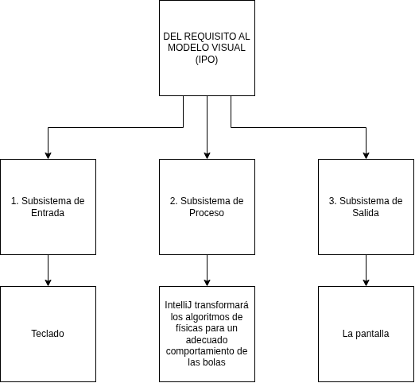

# Dossier técnico de Proyecto Intermodular — Sprint 1 (incremento v0.1)
**Consultora:** AzaharTech Software Consulting  
**Proyecto:** Simulador de fisicas 2D 
**Cliente:**  Riot Games
**Desarrollador/a:** Torres Stanciu, Derek  
**Equipo:** Equipo-04  
**Fecha de entrega:** 2 de octubre de 2026  
**Versión tag:** v0.1.0-sprint1  

---

## 1. Contexto, necesidad y objetivos
Necesitan una animación 2D y nosotros la haremos con Blender y gratis.
* **Alineación con ODS:** ODS 9

---

## 2. Mapa de Actores del Sistema
| Operarios        |         Admins          | Sistemas externos |
| :--------------- | :---------------------: | :---------------- |
| David            |        Portavoz         |                   |
| Derek Torres     |       Secretario        |                   |
| Joan Edo         |       Coordinador       |                   |
| Sebastian Moises | Responsable de Material |                   |

---

## 3. Arquitectura y diagrama de bloques funcional
[Esquema funcional de 3 bloques: Entrada de datos por Scanner -> Procesamiento aritmético y módulo -> Salida estructurada con printf].

---
## 4 . Catálogo de requisitos del sistema y fuentes técnicas

### 4.1. Alcance y objetivos técnicos del Sprint 2
El objetivo de esta fase es estructurar la lógica del software mediante el uso de objetos estándar y clases predefinidas de Java, gestionando la construcción mediante Apache Maven y definiendo con exactitud el comportamiento esperado del sistema.

### 4.2. Catálogo de Requisitos Funcionales (RF)
| Código | Nombre del Requisito | Descripción técnica obligatoria | Prioridad |
| :---: | :--- | :--- | :---: |
| **RF-01** | Captura de parámetros base | El sistema solicitará interactivamente los identificadores y valores iniciales de la operación del cliente. | Alta |
| **RF-02** | Procesamiento de objetos | El sistema empleará clases predefinidas del lenguaje (Scanner, String, Math) para transformar los datos de entrada. | Alta |
| **RF-03** | Generación de identificador | El sistema compondrá un identificador o código alfanumérico combinando prefijos fijos y marcas de transacción. | Media |
| **RF-04** | Resumen estructurado | El sistema emitirá un informe de resultados formateado sin pérdida de precisión numérica. | Media |

### 4.3. Catálogo de Requisitos No Funcionales (RNF)
| Código | Categoría | Restricción técnica o estándar | Verificación |
| :---: | :--- | :--- | :--- |
| **RNF-01** | Entorno y Plataforma | El software debe compilar y ejecutarse bajo OpenJDK 21 LTS sin librerías externas no estándar. | Inspección de compilación |
| **RNF-02** | Gestión de Proyecto | La estructura de carpetas y dependencias debe regirse bajo el estándar de Apache Maven con su archivo `pom.xml`. | Archivo de configuración |
| **RNF-03** | Calidad de Código | Nombres de variables en camelCase, constantes en UPPER_SNAKE_CASE y código autoformateado. | Revisión de estilo |

### 4.4 Fuentes técnicas oficiales contrastadas
1. **Oracle Java SE 21 Specification:** Documentación de la API estándar para clases del paquete `java.lang` y `java.util`. URL: `https://docs.oracle.com/en/java/javase/21/`
2. **Apache Maven Project Standard Directory Layout:** Especificación oficial de la jerarquía de carpetas en proyectos de software. URL: `https://maven.apache.org/guides/introduction/introduction-to-the-standard-directory-layout.html`

### 4.5. Registro ético de uso de Inteligencia Artificial (Prompt Log)
| Fecha | Herramienta | Objetivo de la consulta | Prompt introducido | Revisión crítica y ajuste aplicado |
| :---: | :---: | :--- | :--- | :--- |
| 09/10/2026 | ChatGPT / Claude | Redactar requisitos no funcionales | *"Actúa como analista y redacta 2 requisitos no funcionales SMART para..."* | Se adaptaron las métricas de rendimiento y se eliminaron peticiones de bases de datos externas para respetar el Sprint 2. |
---

## 5. Arquitectura funcional del sistema y previsión de recursos

### 5.1. Diagrama de Bloques Funcional de la Arquitectura
El siguiente esquema técnico modela visualmente el flujo de información y la descomposición en subsistemas de la solución:

*Figura 1. Modelo de arquitectura funcional Entrada-Procesamiento-Salida (IPO).*

### 5.2. Descripción de los Subsistemas
* **Subsistema de Entrada (Captura).** [Describe qué componentes capturan los datos de tu cliente y mediante qué mecanismos].
* **Subsistema de Procesamiento (Lógica Java).** [Explica cómo las clases Java y las operaciones matemáticas transforman los datos en memoria].
* **Subsistema de Salida (Presentación).** [Describe el formato y soporte final donde se presentan los resultados al usuario].

### 5.3. Previsión de Recursos Materiales y Humanos
| Categoría de Recurso | Descripción del Elemento | Justificación Técnica en el Proyecto |
| :--- | :--- | :--- |
| **Recursos Humanos** | Desarrollador/a junior (34 h lectivas) | Análisis, documentación en PI, codificación en PR y control en ED. |
| **Hardware de Desarrollo** | PC con procesador x86_64 y 8 GB RAM | Entorno de compilación local y ejecución fluida de IntelliJ IDEA. |
| **Hardware de Despliegue** | Terminal de cliente / Pantalla operativa | Soporte físico para la visualización del software en producción. |
| **Software de Base** | OpenJDK 21 LTS | Entorno de ejecución estándar multiplataforma mediante la JVM. |
| **Herramientas de Gestión** | Apache Maven 3.9+ / Git & GitHub | Automatización de construcción y control de versiones distribuido. |
---

## 6    . Viabilidad técnica y recursos
* **Tecnología base:** Java SE 21 LTS e IntelliJ IDEA Community Edition.
* **Control de versiones:** Git & GitHub bajo estructura oficial corporativa.
* **Requisitos mínimos:** 3 GB RAM, procesador x86_64/ARM64.

---

## 7. Registro etico de uso de inteligencia artificial (Prompt Log)
Ninguna

---

## 8. Referencias técnicas oficiales
1. Oracle Java Documentation: `https://docs.oracle.com/en/java/javase/21/`
2. Guía oficial de programación del módulo proyecto intermodular (GVA).

---

### Guion de exposición: Sprint Review v0.1 (3 minutos)
* **00:00 - 00:40 (Presentación y proyecto).** Saludo formal, nombre del proyecto, cliente de la bolsa de proyectos y problema crítico que resolvemos.
* **00:40 - 02:10 (Demostración práctica en directo).** Ejecución de `ControlAccesoQR.java` en IntelliJ IDEA, introducción de datos reales por consola y explicación de los resultados calculados con `printf`.
* **02:10 - 03:00 (Ingeniería y repositorio).** Muestra de GitHub, confirmación del tag `v0.1.0-sprint1` y mención al objetivo del Sprint 2 (uso de objetos estándar y estructura Maven).